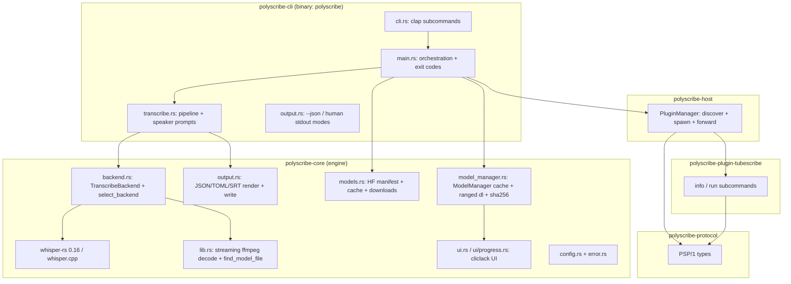

# PolyScribe — Architecture, Functionality & MVP Audit

- Date: 2026-10-21
- Repository: `polyscribe` at commit `a78a4e0` (branch `dev`)
- Scope: strictly read-only audit. No source files were modified. This report is the only repository-local file created (left untracked).
- Method: repository inventory, re-execution of all quality gates, live functional testing of every user-facing workflow in isolated temporary directories (`/tmp/opencode/audit`), and focused code review. Existing artifacts were reused where possible: the `ggml-tiny.en.bin` model (77.7 MB, SHA-256 `921e4cf8…920b1f`, matches the upstream hash) and an espeak-ng speech fixture from the earlier integration work, plus the committed fixtures in `crates/polyscribe-cli/tests/fixtures/`.

Classification used in the functionality matrix: **Verified working** (executed successfully), **Verified broken** (reproduced failure), **Partially working** (important limitations demonstrated), **Not verified** (insufficient environment/fixtures/access), **Not implemented** (confirmed missing).

---

## A. Architecture overview

### Workspace layout

Cargo workspace (resolver 3, edition 2024, MSRV 1.88, workspace lints applied to all crates):

| Crate | Kind | Responsibility |
|---|---|---|
| `crates/polyscribe-core` | library | Engine: `backend.rs` (backend selection, `TranscribeBackend` trait, whisper-rs glue), `lib.rs` (runtime flags, logging macros, stderr silencing, model discovery `find_model_file`, streaming ffmpeg decode, SRT rendering), `output.rs` (transcript types helpers, `sort_and_reindex`, JSON/TOML/SRT serialization, transcript loading), `models.rs` (HF manifest fetch + cache, HEAD enrichment, resumable downloads, interactive downloader, `update_local_models`), `model_manager.rs` (`ModelManager`: manifest `models.json`, cache dir, ranged concurrent downloads, SHA-256 verification, `ls/rm/verify/gc/add_or_update`), `config.rs` (env-var configuration, XDG paths), `error.rs` (core error enum), `ui.rs` + `ui/progress.rs` (cliclack prompts, spinners, progress bars) |
| `crates/polyscribe-cli` | binary `polyscribe` | `cli.rs` (clap subcommands), `main.rs` (orchestration: transcribe/models/plugins/completions/man, tracing init), `transcribe.rs` (the transcription pipeline: input validation, backend selection, the three output modes, speaker prompts), `output.rs` (stdout modes: `--json`/human) |
| `crates/polyscribe-host` | library | Plugin discovery (PATH + XDG plugin dir), process spawn, stdio forwarding |
| `crates/polyscribe-protocol` | library | PSP/1 protocol types: `Request`/`JsonRpcRequest`, `Capabilities`, `StreamItem`, `ErrorObj` |
| `plugins/polyscribe-plugin-tubescribe` | binary | Reference plugin (workspace member): `info` prints capabilities JSON, `run` serves one JSON-RPC request over NDJSON stdio |

### Component interaction

### Important data flows

1. **Transcribe**: CLI parses args → validates inputs → `--language` required for audio → `select_backend` (compile-time feature gating) → per input: `collect_entries_for_input` (audio → ffmpeg stream decode → whisper `full()` → segments; JSON → `load_json_transcript`) → `sort_and_reindex` → `write_output_files` (JSON+TOML+SRT with `YYYY-MM-DD_` prefix) or `write_json_stdout`.
2. **Models**: `models` subcommands → `ModelManager` (cache dir + `models.json` manifest) → HF API (rustls HTTPS) for metadata → ranged concurrent GETs with streaming fallback → SHA-256 verify → atomic `.part` rename. Manifest cached with ETag/TTL (`$XDG_CACHE_HOME/polyscribe/manifest/`).
3. **Plugins**: `plugins list/info/run` → `PluginManager` scans `PATH` + `$XDG_DATA_HOME/polyscribe/plugins` for executable `polyscribe-plugin-*` → spawn with NDJSON stdio → forward stdout.

### Inventory notes

- CLI: `transcribe`, `models` (ls/add/rm/verify/update/download/clear-cache/gc/search), `plugins` (list/info/run), `completions`, `man`. Global `--json`/`--quiet`; top-level `-v`/`--no-interaction`/`--no-progress`. `--gpu-layers` exists but is hidden and unused.
- Configuration: environment variables only (`POLYSCRIBE_MODELS_DIR`, `WHISPER_MODEL`, `POLYSCRIBE_CACHE_DIR`, `POLYSCRIBE_CONFIG_DIR`, `POLYSCRIBE_NO_CACHE_MANIFEST`, `POLYSCRIBE_MANIFEST_TTL_SECONDS`, `POLYSCRIBE_HF_REPO`, `HF_TOKEN`, `XDG_*`). No config file.
- Persistence: ModelManager manifest + model cache, HF manifest cache, `.part` temp files (guarded). No session management.
- Docs: `README.md`, `CONTRIBUTING.md`, `TODO.md`, `CHANGELOG.md`, `docs/{usage,development,design,faq,ci,release-packaging}.md`. No `examples/` directory (removed during integration). Accurate as of this audit (claims cross-checked during testing).
- CI: `.github/workflows/ci.yml` — Linux only; jobs: fmt, locked workspace build, locked workspace tests, clippy `-D warnings` (stable), MSRV 1.88 check. No GPU job, no end-to-end transcription test.
- Toolchain: `rust-toolchain.toml` pins 1.89.0 (auto-installed and used). MSRV declared 1.88.
- Tests: 60 tests (8 CLI unit, 3 aux, 5 models smoke, 20 transcribe integration, 5 plugin e2e, 19 core unit). Fixtures: 6 files in `crates/polyscribe-cli/tests/fixtures/`.

---

## B. Functionality matrix

| # | Feature | Status | Evidence (executed 2026-10-21) | Limitations |
|---|---|---|---|---|
| 1 | Fresh build | Verified working | `cargo build --workspace --all-targets` succeeds; `cargo fmt --all -- --check` OK; `cargo clippy --workspace --all-targets -- -D warnings` OK; `cargo test --workspace` 60/60 pass | Requires cmake + C/C++ toolchain + libclang (documented in README/development.md) |
| 2 | CLI help, discovery, argument handling | Verified working | `-h` for all subcommands; no args exits 2 with help; invalid subcommand and invalid `--gpu-backend vulkan`/`completions tcsh` rejected with valid values listed; `--version` prints `polyscribe 0.1.0`; `completions`/`man` emit scripts/roff | `-v`/`--no-interaction`/`--no-progress` are top-level only (must precede the subcommand) |
| 3 | Local audio transcription (WAV) | Verified working | `transcribe --language en speech.wav` with `ggml-tiny.en` → exit 0, valid JSON/TOML/SRT, correct timestamps (0.0–3.62 s) | Whole recording held in memory (see F-10); no cancellation |
| 4 | Video transcription (MP4) | Verified working | ffmpeg-made MP4 → exit 0, outputs produced | Same as #3 |
| 5 | JSON transcript merging | Verified working | `-m` two fixtures → stdout JSON sorted by start, ids 0..3, speakers from stems; single input → stdout JSON | None observed |
| 6 | Output formats (JSON/TOML/SRT/stdout) | Verified working | Separate mode → 6 files; merge-to-file-base → date-prefixed set; merge-and-separate → 9 files; SRT content byte-exact vs expected; TOML parses; stdout JSON pretty-printed | None observed |
| 7 | Model install / list / verify / remove / gc | Verified working | `models add` downloaded 77.7 MB over HTTPS, SHA-256 in manifest matches upstream (`921e4cf8…`); `verify` → ok; `ls`/`ls --json`; `rm` (exit 2 when missing); `gc`; re-`add` hits ETag 304 fast path; second `update` skips via 304 (6 s, no re-download) | `rm` leaves a stale manifest entry if the manifest write fails (F-04) |
| 8 | Model search / update / clear-cache / download | Verified working | `search` over HTTPS/rustls returns results; offline `search` fails gracefully with exit 3; `clear-cache` OK; `download` skips in `--no-interaction` and when stdin is not a TTY (exit 0); `update` ETag skip verified on second run | First `update` after an ETag rotation re-downloads (expected); interactive `download` not exercisable without a TTY |
| 9 | Plugin discovery / execution / failure handling | Verified working | `plugins list` → tubescribe; `info` → capabilities JSON on stdout; `run` → NDJSON progress + result stream; unknown plugin → clear error, exit 1 | Plugin-level errors (error item in the stream) do not propagate to the exit code (F-06); no sandboxing/signatures (F-07) |
| 10 | Invalid input and error recovery | Verified working | Missing file, invalid JSON, unsupported type, audio without `--language`, multiple inputs without `-m`/`-o`, `--merge-and-separate` without `-o`, `--gpu-backend cuda` on a CPU build: all produce actionable messages, exit 1 (clap rejections exit 2) | Piping stdout into `head` yields `Error: Broken pipe` (F-11) |
| 11 | Configuration (env vars, XDG) | Verified working | `POLYSCRIBE_MODELS_DIR`, `WHISPER_MODEL` (incl. clear error when missing), `XDG_CACHE_HOME`/`XDG_CONFIG_HOME`/`XDG_DATA_HOME`, `POLYSCRIBE_CACHE_DIR`/`POLYSCRIBE_CONFIG_DIR` all honored | Two divergent models-dir resolvers (F-02); no config file |
| 12 | Filesystem permissions | Partially working | Read-only output dir → graceful `Failed to create output file`; read-only config dir → graceful `Permission denied`, exit 1 | `models rm` into a read-only config dir removes the file but leaves the manifest referencing it (F-04) |
| 13 | CPU execution | Verified working | CPU-only build: `auto` selects Cpu; transcription runs on CPU | — |
| 14 | GPU backends | Partially working | Feature wiring verified (`gpu-cuda`/`gpu-hip` resolve; HIP build links against ROCm 7.2 per prior integration evidence); actionable errors when a backend was not compiled in | CUDA build not verifiable (no toolkit); runtime GPU inference not executed (no GPU test); Vulkan removed by design |
| 15 | Behavior without network | Verified working | `unshare -rn`: JSON merge exit 0; audio transcription exit 0; `models ls` works; `models search` fails gracefully exit 3 | — |
| 16 | Speaker diarization | Not implemented | Speaker labels are manual (`--set-speaker-names`) or file-stem defaults; documented in README/FAQ | `tinydiarize` models are listed by the downloader but not wired into transcription |
| 17 | Long-running recordings | Partially working | Works end to end, but memory is O(duration) (~230 MiB/hour of audio) and there is no cancellation or chunking | Architectural limit (F-10); relevant to the original TTRPG-session use case |
| 18 | Microphone / URL / dictation input | Not implemented | File-based only | Future direction (TODO F2) |
| 19 | TUI / GUI frontends | Not implemented | CLI only | Future direction (TODO L1) |
| 20 | Windows / macOS | Not verified | Static review: Windows does not compile (F-03); macOS likely compiles but is untested; CI is Linux-only | Windows confirmed broken at compile time (static, high confidence) |
| 21 | First-run experience (no model installed) | Verified broken | Reproduced twice: empty models dir + missing cache dir, and read-only models dir + missing cache dir → `Error: Failed to read models dir: /home/<user>/.cache/polyscribe/models` instead of the actionable "download a model" message | F-01; hits every new user |

---

## C. Prioritized findings

### F-01 — First-run "no model" error is masked by a wrong directory (High)

- Category: Correctness / UX. File: `crates/polyscribe-core/src/lib.rs:357-363` (fallback), `:381` (`scan_model_dir`).
- Evidence: `find_model_file` falls back to the ModelManager cache dir with `candidates = scan_model_dir(&paths.cache_dir)?;` (line 363). When the cache dir does not exist, `read_dir` fails and the error propagates, replacing the intended message. Reproduced twice on 2026-10-21: (a) `POLYSCRIBE_MODELS_DIR=<empty dir>` + no `~/.cache/polyscribe/models`; (b) read-only models dir + missing cache dir. Both print `Error: Failed to read models dir: /home/cnachtigall/.cache/polyscribe/models` instead of `No Whisper model files (*.bin) found in <dir>. Please download a model (polyscribe models add) or set WHISPER_MODEL.`
- User impact: every first-time user with no model installed gets a confusing error naming a directory they never configured, with no remediation hint.
- Recommended resolution: make the fallback tolerant — `if let Ok(found) = scan_model_dir(&paths.cache_dir) { candidates = found; }` — so a missing/unreadable cache dir counts as "no candidates" and the actionable error is shown.
- Confidence: confirmed (reproduced twice).

### F-02 — Debug and release builds resolve the models dir differently (Medium)

- Category: Consistency. Files: `crates/polyscribe-core/src/lib.rs:229-231` (`models_dir_path` special-cases `cfg!(debug_assertions)` → `./models`) vs `crates/polyscribe-core/src/config.rs:57` (`ConfigService::models_dir` has no debug special-case → XDG data dir).
- Evidence: demonstrated with the release binary present: with a model only in `$XDG_DATA_HOME/polyscribe/models`, the release build transcribes successfully, while the debug build fails (and shows the F-01 error). The interactive downloader (`models download` → `ensure_model_available_noninteractive` → `resolve_models_dir`) always uses `ConfigService::models_dir`, i.e. the XDG data dir even in debug builds.
- User impact: developers running `cargo run -- models download` then `cargo run -- transcribe …` in a debug build download a model that `transcribe` will not find. Release/`cargo install` builds are consistent.
- Recommended resolution: unify on a single resolution function with one debug/release policy (already tracked as TODO D2).
- Confidence: confirmed (demonstrated with both binaries).

### F-03 — Workspace does not compile on Windows (Medium, static)

- Category: Portability. Files: `crates/polyscribe-host/src/lib.rs:3` (`use std::{…, os::unix::fs::PermissionsExt, …}` — `std::os::unix` does not exist on Windows; the `#[cfg(unix)]` at line 98 gates only the usage) and `crates/polyscribe-core/src/models.rs:43` (`use libc::statvfs;` in `free_space_bytes_for_path`, lines 42-61 — `libc::statvfs` is unavailable on Windows; not cfg-gated).
- Evidence: static review. Both APIs are definitively absent on Windows targets. CI is Linux-only, so this is undetected. macOS is unaffected (both APIs exist there).
- User impact: no Windows build at all; the crate set silently assumes Unix.
- Recommended resolution: cfg-gate both. For `is_executable`, fall back to `path.is_file()` on non-Unix; for the disk-space check, gate the function and return "unknown" (skip the check) on non-Unix, or use a cross-platform crate.
- Confidence: high (static; a Windows cross-compile was not run because adding toolchain targets is out of scope for a read-only audit).

### F-04 — `ModelManager::rm` deletes the file before saving the manifest (Medium)

- Category: Reliability. File: `crates/polyscribe-core/src/model_manager.rs:331-340` (`fs::remove_file` at line 335, `save_manifest` at line 336).
- Evidence: with a read-only `POLYSCRIBE_CONFIG_DIR` containing an existing manifest, `models rm <alias>` fails with `Permission denied (os error 13)`, exit 1 — after the cache file was already removed. The manifest still references the deleted file until a later `gc`.
- User impact: a failed `rm` leaves the manifest and the cache inconsistent (`ls` shows a model whose file is gone; `verify` reports corrupt).
- Recommended resolution: save the manifest first, then remove the file (or restore the file on save failure).
- Confidence: confirmed (reproduced).

### F-05 — No end-to-end transcription test in CI (Medium)

- Category: Test coverage. File: `.github/workflows/ci.yml:30-31` (test job runs `cargo test --workspace --locked`; the workflow contains zero references to models/whisper/tiny).
- Evidence: the only coverage of the core user workflow (audio → transcript) is manual. This audit reproduced it successfully, and the 60-test suite covers everything around it (decode failure path, merge semantics, output formats), but nothing exercises real whisper inference. A regression like the whisper-rs 0.14→0.16 API migration would not be caught by CI.
- User impact: the alpha could ship a broken transcription pipeline with green CI.
- Recommended resolution: add a CI job that downloads `ggml-tiny.en` once (actions cache), generates a short WAV with ffmpeg, transcribes it, and asserts valid JSON/SRT output (tracked as TODO D4/D6).
- Confidence: confirmed (workflow inspected; test inventory inspected).

### F-06 — Inconsistent exit codes and silent plugin-level failures (Low)

- Category: CLI design. Files: `crates/polyscribe-cli/src/main.rs:118-122` (models exit codes 0/2/3/4), `:613-619` (plugin run checks only the plugin process status); transcribe/plugins return anyhow errors → exit 1 for everything.
- Evidence: `models verify <missing>` → exit 2; `transcribe` validation errors → exit 1; `plugins run tubescribe badmethod` → the plugin emits an error item in the NDJSON stream and exits 0, so the CLI exits 0.
- User impact: scripts must special-case exit codes per subcommand; a plugin-level error is invisible to `$?`.
- Recommended resolution: define one exit-code contract (e.g. 0 ok, 1 usage/validation, 2 not found, 3 network, 4 verification failed), document it, and map a trailing plugin error item to a non-zero exit.
- Confidence: confirmed (exit codes measured directly).

### F-07 — Plugin trust model undocumented; unverified downloads possible (Low, accepted-risk)

- Category: Security / privacy. Files: `crates/polyscribe-host/src/lib.rs:23-40,75-95` (runs any executable named `polyscribe-plugin-*` found on `PATH` or in the XDG plugin dir, no sandboxing/signatures/checksums); `crates/polyscribe-core/src/model_manager.rs:625` (SHA-256 verification is conditional: only when the HF API or a previous record provides a hash).
- Evidence: code review plus live plugin execution. The core `models.rs` download path warns loudly when no checksum is available (`models.rs:922`); the ModelManager path is silent.
- User impact: a malicious executable on PATH with the plugin prefix runs with the user's privileges (inherent to plugin systems, like git hooks, but undocumented); a download without a known hash is accepted silently by `models add`.
- Recommended resolution: document the plugin trust model in the README; make `add_or_update` warn (or refuse, behind a flag) when no checksum is available.
- Confidence: confirmed by code review; not a vulnerability in the classic sense (no untrusted input crosses a trust boundary beyond the documented plugin mechanism), so severity is Low.

### F-08 — Dead scaffolding: unused public functions (Low)

- Category: Code quality. Files: `crates/polyscribe-core/src/ui.rs:40` (`note`), `:114` (`prompt_password`), `:124` (`prompt_input_validated`); `crates/polyscribe-core/src/models.rs:652` (`pick_best_local_model`, superseded by `find_model_file`'s own scan), `:1092` (`update_local_models`, never wired to any CLI command).
- Evidence: workspace-wide grep shows no call sites for any of them.
- User impact: none directly; they inflate the API surface and invite misuse.
- Recommended resolution: remove them, or wire `update_local_models` as a CLI command if the transcription-dir update flow is wanted.
- Confidence: confirmed (grep).

### F-09 — Human-size formatting implemented three times (Low)

- Category: Code quality / duplication. Files: `crates/polyscribe-cli/src/main.rs:42` (`human_size`), `crates/polyscribe-core/src/models.rs:20,30` (`format_size_mb`/`format_size_gib`), `crates/polyscribe-core/src/ui.rs:229` (`BytesProgress::human_bytes`).
- Evidence: three independent implementations of the same formatting (minor output differences: `?` vs `MiB` handling).
- User impact: inconsistent size strings across subcommands.
- Recommended resolution: one shared helper in core, used by all three sites.
- Confidence: confirmed (grep).

### F-10 — Performance and scaling limits (Low)

- Category: Performance. Files: `crates/polyscribe-core/src/lib.rs:456` (`let mut pcm = Vec::new();` — the whole PCM buffer is accumulated), `crates/polyscribe-core/src/backend.rs:283` (`state.full(full_params, &pcm_samples)` — whisper needs the entire buffer in memory), `crates/polyscribe-core/src/lib.rs:200-218` (`render_srt` uses `push_str(&format!(…))` per line), `crates/polyscribe-core/src/models.rs:625-628` (manifest enrichment issues sequential HEAD requests).
- Evidence: code review. ~64 KiB/s of 16 kHz f32 mono audio means roughly 230 MiB of RAM per hour of recording, with no chunking or cancellation. This is the main scaling limit for the original long-session (TTRPG/DSA) use case.
- User impact: long recordings will exhaust memory; no benchmark was run, so no numbers are claimed beyond the arithmetic.
- Recommended resolution: document the limit for the alpha (TODO D3); chunked/streamed transcription is a post-alpha architecture item, not an alpha blocker.
- Confidence: confirmed by code review (architectural, not measured).

### F-11 — Piping stdout into a short consumer errors confusingly (Low)

- Category: UX. Evidence: `polyscribe transcribe -m a.json | head -3` prints `Error: Broken pipe (os error 32)` and exits 1 (Rust's default SIGPIPE behavior with `println!`).
- User impact: scripts that truncate output (`| head`) see a spurious error.
- Recommended resolution: ignore EPIPE on stdout writes (or use a writer that treats EPIPE as success).
- Confidence: confirmed (reproduced).

### F-12 — Error message leaks an internal variant name (Info)

- Category: Polish. File: `crates/polyscribe-core/src/error.rs:20-21` (`Error::Http` displays as `http error: {0}`).
- Evidence: offline `models search` prints `error: http error: error sending request for url (https://huggingface.co/…)`.
- User impact: cosmetic; reads like an internal leak.
- Recommended resolution: reword to `network error: …` or similar.
- Confidence: confirmed (reproduced offline).

---

## D. Alpha release definition (`v0.1.0-alpha.1`)

### Proposed scope (smallest coherent, genuinely useful set)

A reliable, local-first CLI:

1. `transcribe`: audio/video file → JSON + TOML + SRT (separate, `-m` merge, `--merge-and-separate` modes), JSON to stdout, `--language`, `--set-speaker-names`, quiet/verbose/no-interaction.
2. `models`: `ls`, `add`, `rm`, `verify`, `gc`, `search`, `update`, `clear-cache` (Hugging Face over HTTPS with SHA-256 verification and ETag caching).
3. `completions` + `man`.
4. CPU build by default; optional `gpu-cuda` / `gpu-hip` builds.
5. The reference plugin (`plugins list/info/run`) as a documented extension example.
6. Docs (README/usage/faq/development) and CI (fmt, locked build/test, clippy `-D warnings`, MSRV 1.88) as they stand.

Explicitly out of scope for the alpha: diarization, mic/URL input, dictation, TUI/GUI, Windows support, chunked long-file transcription.

### Acceptance criteria

- All CI jobs green: `cargo fmt --all -- --check`, `cargo build --workspace --all-targets --locked`, `cargo test --workspace --locked` (60 tests), `cargo clippy --workspace --all-targets -- -D warnings`, `cargo +1.88 check --workspace --all-targets --locked`.
- Manual smoke (scripted, repeatable): transcribe a short WAV with `ggml-tiny.en` → valid JSON/TOML/SRT; merge two JSON transcripts → sorted output with sequential ids; `models add` → `verify` → `ls` → `rm` round-trip; `plugins list/info/run` with the reference plugin.
- No open High/Critical findings.
- First-run experience: a user with no model gets the actionable "download a model" message (F-01 fixed).

### Release blockers

- **B1 (F-01)**: fix the first-run error masking (`lib.rs:363`). Trivial fix; this is the first thing a new user hits.
- **B2 (F-05)**: add the end-to-end transcription test to CI before tagging. Moderate effort (one job + cached model); without it the alpha has no automated guarantee for its core workflow.

### Important post-alpha improvements (not blockers)

- F-02 (unify models-dir resolution; affects the `cargo run` dev flow only).
- F-03 (Windows compile support; alpha targets Linux/macOS).
- F-04 (atomic `rm`).
- F-06 (exit-code contract).
- macOS CI job.

### Optional enhancements

- F-07 (document plugin trust model; warn on unverified downloads), F-08 (remove scaffolding), F-09 (dedupe human-size), F-11 (EPIPE), F-12 (error wording).

### Long-term architectural opportunities (deliberately waiting)

- Chunked/streamed transcription for long sessions (F-10; needs a streaming whisper API or VAD-based segmentation).
- Speaker diarization (`--diarize`, tinydiarize models).
- Additional engines behind `TranscribeBackend` (local Voxtral-class models, optional remote providers).
- Mic/URL ingestion, push-to-talk, dictation; ytt integration for YouTube.
- TUI/GUI frontends consuming `polyscribe-core`.

---

## E. Issue backlog (issue-ready; not created on any forge)

1. **Fix first-run "no model" error masking in find_model_file** (blocker)
   - Description: `find_model_file` falls back to the ModelManager cache dir with `scan_model_dir(&paths.cache_dir)?` (`crates/polyscribe-core/src/lib.rs:363`). When the cache dir is missing/unreadable, the `read_dir` error propagates and masks the actionable "No Whisper model files found in `<dir>`. Please download a model (polyscribe models add) or set WHISPER_MODEL." message. Users see `Error: Failed to read models dir: ~/.cache/polyscribe/models`.
   - AC: with an empty models dir and no cache dir, `transcribe --language en valid.wav` prints the actionable message and exits non-zero; a unit/integration test covers it.
   - Depends on: nothing. Blocks: alpha tag.

2. **Add an end-to-end transcription test to CI** (blocker)
   - Description: CI (`.github/workflows/ci.yml`) runs unit/integration tests only; nothing exercises real whisper inference. Add a job that downloads `ggml-tiny.en` (actions cache), generates a short WAV with ffmpeg (espeak-ng or a committed fixture), runs `polyscribe transcribe --language en`, and asserts valid JSON/SRT output with sane timestamps.
   - AC: the job is green and fails if the transcription pipeline breaks (e.g. a whisper-rs API change).
   - Depends on: nothing. Blocks: alpha tag.

3. **Unify models-dir resolution across debug/release and subsystems**
   - Description: `models_dir_path()` (`lib.rs:229-231`) uses `./models` in debug builds; `ConfigService::models_dir()` (`config.rs:57`) always uses the XDG data dir. The interactive downloader uses the latter, so `cargo run -- models download` in debug installs a model that `cargo run -- transcribe` will not find (demonstrated). Unify on one resolver with one policy (TODO D2).
   - AC: debug and release builds resolve the same default dir; the downloader and `transcribe` agree; tests cover both.
   - Depends on: nothing.

4. **Make the workspace compile on Windows**
   - Description: `crates/polyscribe-host/src/lib.rs:3` imports `std::os::unix::fs::PermissionsExt` unconditionally; `crates/polyscribe-core/src/models.rs:43` uses `libc::statvfs` ungated. Both are absent on Windows. cfg-gate them with non-Unix fallbacks.
   - AC: `cargo check --workspace --target x86_64-pc-windows-msvc` passes (or the equivalent CI job); disk-space check degrades gracefully on non-Unix.
   - Depends on: nothing.

5. **Make ModelManager::rm atomic (manifest before file)**
   - Description: `rm` deletes the cache file before saving the manifest (`model_manager.rs:331-340`). A manifest-write failure leaves a stale entry (demonstrated with a read-only config dir).
   - AC: a failed `rm` leaves the manifest and cache consistent (entry kept if the file could not be removed; file removed only after the manifest is saved, or rollback on failure); test with an unwritable config dir.
   - Depends on: nothing.

6. **Define and document a consistent exit-code contract**
   - Description: `models` uses 0/2/3/4; `transcribe`/`plugins` use 1 for all errors; plugin-level error items exit 0. Publish one contract in `docs/usage.md` and implement it.
   - AC: every subcommand maps failures to the documented codes; `plugins run` exits non-zero when the stream ends with an error item; integration tests assert the codes.
   - Depends on: nothing.

7. **Remove dead scaffolding and duplicated helpers**
   - Description: delete or wire `ui::note` (`ui.rs:40`), `ui::prompt_password` (`ui.rs:114`), `ui::prompt_input_validated` (`ui.rs:124`), `models::pick_best_local_model` (`models.rs:652`), `models::update_local_models` (`models.rs:1092`); replace the three human-size implementations (`cli/main.rs:42`, `models.rs:20,30`, `ui.rs:229`) with one core helper.
   - AC: no unused public functions remain (or each is deliberately wired); one human-size helper; clippy/tests stay green.
   - Depends on: nothing.

8. **Handle EPIPE gracefully on piped stdout**
   - Description: `polyscribe … | head` currently prints `Error: Broken pipe (os error 32)` and exits 1.
   - AC: piping into a short consumer exits quietly; tests or a smoke check cover it.
   - Depends on: nothing.

9. **Document the plugin trust model; warn on unverified downloads**
   - Description: plugins are arbitrary executables on `PATH`/XDG dir with no sandboxing or signatures (accepted for an alpha, but undocumented); `ModelManager::add_or_update` silently accepts a download when no SHA-256 is known (`model_manager.rs:625`).
   - AC: README documents the trust model; `models add` warns when a download cannot be verified.
   - Depends on: nothing.

10. **Chunked/streamed transcription for long recordings (post-alpha architecture)**
    - Description: the whole PCM buffer is held in memory (~230 MiB/hour) and `whisper_full` needs it all; no cancellation. Prototype chunked transcription or VAD segmentation behind the existing `TranscribeBackend` trait.
    - AC: a long fixture (e.g. 30+ min) transcribes with bounded memory; peak RSS measured before/after.
    - Depends on: whisper-rs streaming/VAD API availability; keep the current path as fallback.

---

## F. Executive summary

1. **What is already solid?** The integrated workspace builds clean and passes every gate I re-executed: `cargo fmt --check`, `cargo build --workspace --all-targets`, `cargo clippy --workspace --all-targets -- -D warnings`, and 60/60 tests. The core user workflow is real and verified end to end: audio and video transcription with whisper.cpp (correct timestamps, valid JSON/TOML/SRT), JSON transcript merging with correct sort/id/speaker semantics, the full models lifecycle (download with SHA-256 matching the upstream hash, ETag 304 skips, verify/rm/gc/ls/search over rustls HTTPS), the plugin system (list/info/run with NDJSON streaming), offline operation, and actionable error messages with correct exit codes on every invalid-input path I tried. Path-safety guards, atomic `.part` renames, and temp-file guards are in place; there is no telemetry and network access is confined to the `models` subcommands. Documentation matches the implementation.

2. **What is actually broken?** The first-run experience: a user with no model installed gets `Error: Failed to read models dir: ~/.cache/polyscribe/models` instead of the actionable "download a model" message (F-01, reproduced twice). Debug builds resolve the models dir differently from release builds, so the interactive downloader installs models where debug `transcribe` will not look (F-02, demonstrated with both binaries). The workspace does not compile on Windows (F-03, static: ungated `std::os::unix` and `libc::statvfs` imports). `models rm` can leave a stale manifest entry when the manifest write fails (F-04, reproduced).

3. **What is missing for the alpha?** An automated end-to-end transcription test in CI (F-05): today the single most important workflow is only covered by manual verification. Everything else needed for a useful alpha (CLI, transcription, merging, model management, plugins, docs, CI gates) is present and working.

4. **What should be implemented first?** The two blockers, in order: fix the first-run error masking (F-01, a one-line tolerance fix in `find_model_file`), then add the CI end-to-end transcription job (F-02... correction: F-05) using the tiny model and an ffmpeg-generated fixture. Both are small and make the alpha trustworthy.

5. **What should deliberately wait?** Diarization, microphone/URL/dictation input, TUI/GUI frontends, Windows support, chunked long-file transcription, additional engines (Voxtral-class, remote providers), and the cosmetic cleanups (exit-code contract polish, dead scaffolding removal, EPIPE handling, error wording). These are post-alpha items in the backlog above; none of them is needed for a reliable CLI alpha.

---

*End of audit. Report file: `audit-2026.md` (untracked). No tracked files were modified; temporary test artifacts were confined to `/tmp/opencode/audit`.*
